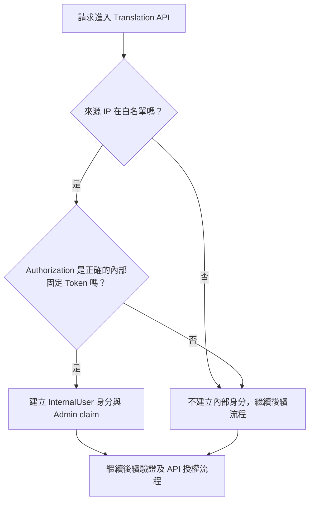
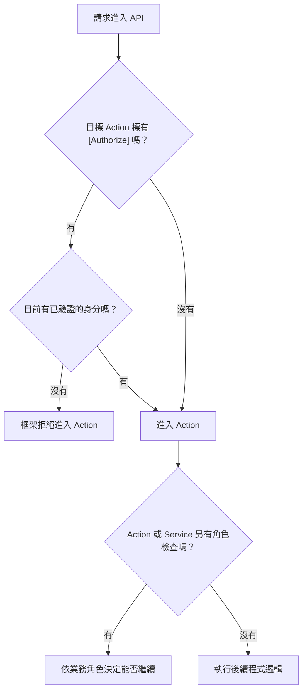
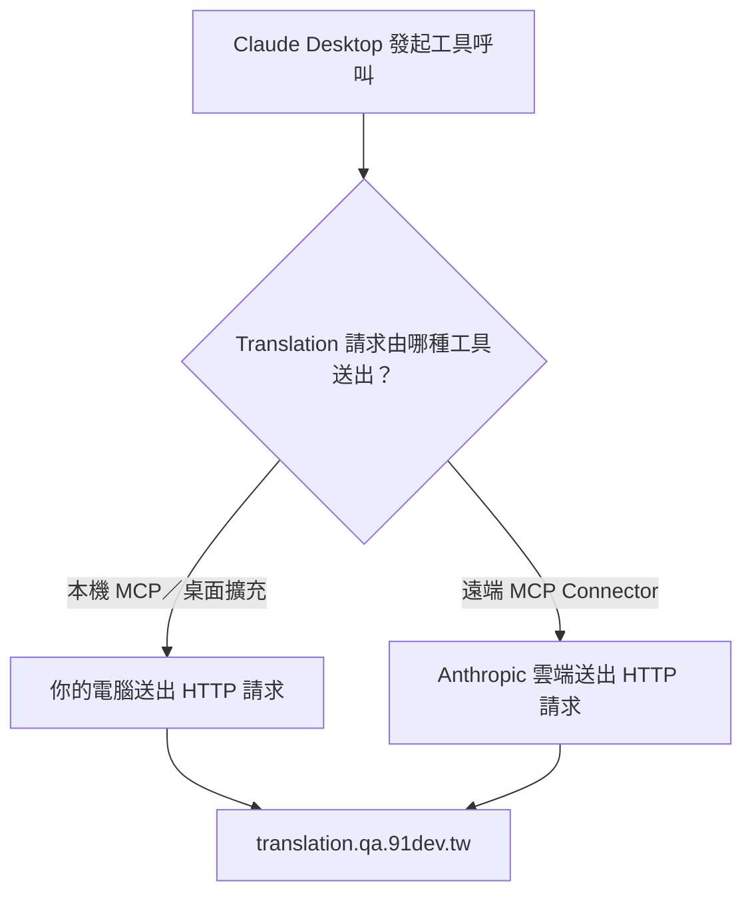
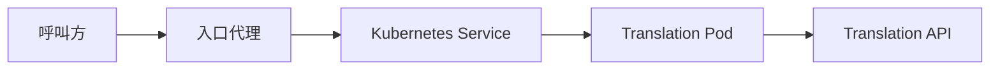
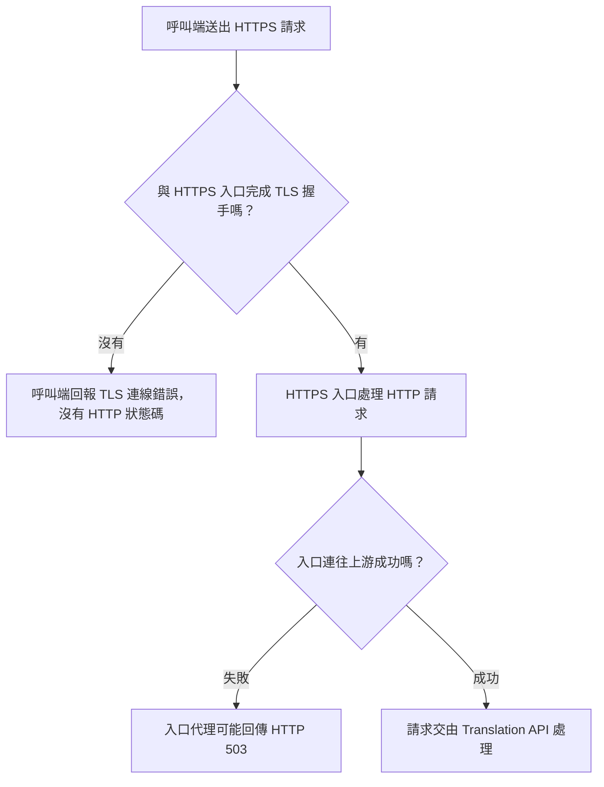




<!-- tab 案件->


使用者說他在辦公室使用 Claude Desktop 呼叫公司內部的多語系服務卡在 503，怎麼辦?


<!-- endtab -->


<!-- tab InternalIpAuthorizationMiddleware-->

Translation API 接到請求時，會先檢查是否符合「內部請求」的兩個條件

- 來源 IP 在設定的白名單中
- `Authorization` 標頭帶有正確的內部固定 Token。兩個條件都符合，程式就為這次請求建立內部使用者身分；任一條件不符，請求仍會繼續往後處理。這段程式本身不會封鎖外部 IP


## 請求經過哪些判斷？



`Startup.Configure` 先執行 `InternalIpAuthorizationMiddleware`，接著執行 `UseAuthentication()`，最後在路由階段執行 `UseAuthorization()`。因此，內部請求即使取得了內部身分，仍會繼續通過後面的 Middleware；它不是在 IP 檢查後直接跳到 API。Firebase 是 Google 提供的應用服務，這個專案使用它的登入驗證功能。一般使用者登入後取得 Firebase Token，由 API 的 JWT 驗證設定檢查簽發者、使用對象與有效期限。API 是否要求登入，還要看該 endpoint 的授權設定。


## IP 怎麼取得？

程式先讀取網路連線的 `RemoteIpAddress`。如果請求有 `X-Forwarded-For` 標頭，就改用標頭中的第一個 IP。這是為了處理請求先經過代理或負載平衡器的情況，此時網路連線的對方可能是代理，而非原始呼叫者。

白名單來自 `InternalAuth:AllowedIps`。目前 `appsettings.json` 與 `appsettings.Development.json` 都列出三個 IP；實際使用的設定值仍可能被部署環境的設定覆蓋。這段程式沒有自行驗證 `X-Forwarded-For` 是否由可信任代理寫入，因此入口代理如何處理這個標頭，是 IP 判斷能否信任的前提。


## 內部固定 Token 從哪裡來？

這個 Token 不會在每次請求時產生。它事先存放在設定鍵 `InternalAuth:PermanentToken`，呼叫方以 `Authorization: Bearer <內部固定 Token>` 傳入。Middleware 會將整個標頭與設定值組成的字串完全比對，並同時檢查 IP。`appsettings.Development.json` 有自己的設定值；其他環境使用哪個值，須以實際載入的設定為準。

內部固定 Token 與 Firebase Token 是兩種不同的憑證。前者由這段 Middleware 直接比對設定字串；後者由 Firebase 登入流程取得，再由 API 的 JWT 驗證設定檢查。固定 Token 必須保密，公開文件不應列出它的實際值。


## 建立的身分與 `Admin` claim 代表什麼？

條件符合時，Middleware 會建立一個已驗證的 `ClaimsIdentity`，放入名稱 `InternalUser`、代表內部使用者的 Email，以及值為 `Admin` 的角色 claim。Claim 是附在使用者身分上的一筆資料，後續授權程式可以讀取它。

這裡的 `Admin` claim 不等於專案所有功能都取得管理員權限。`UserRepo` 另從 Email 與角色名單計算業務角色，兩者是不同的判斷。請求最後能執行哪些功能，還要看各 endpoint 與業務邏輯如何檢查身分及角色。


## 關鍵字

| 位置 | 對應行為 |
|---|---|
| `Startup.cs` | 註冊內部 IP Middleware、Firebase JWT 驗證與授權流程 |
| `Utils/InternalIpAuthorizationMiddleware.cs` | 取得 IP、比對白名單與固定 Token、建立內部身分 |
| `Repos/UserRepo.cs` | 從身分中的 Email 計算業務角色 |
| `appsettings.json`、`appsettings.Development.json` | 提供白名單與內部固定 Token 的預設設定 |


<!-- endtab -->


<!-- tab [Authorize]-->


`[Authorize]` 是 ASP.NET Core 放在 Controller 或 Action 上的授權標記。請求進入標有 `[Authorize]` 的 Action 前，框架會要求目前請求具有已驗證的使用者身分。在這個專案中，身分可能來自 Firebase JWT，也可能由前一段的內部 IP Middleware 建立。`[Authorize]` 本身只要求「已有驗證身分」，沒有指定必須是 `Admin` 或 `Translator`。


## 請求如何通過這一層？




沒有標 `[Authorize]`，表示這個 endpoint **沒有在進入 Action 前強制要求已驗證身分**。它不保證呼叫一定成功：Action 內可能另有角色檢查，程式可能因資料或外部服務而失敗，部署入口也可能限制網路來源。


## 登入身分與業務角色是兩道不同的判斷

`[Authorize]` 使用目前請求的已驗證身分。需要檢查業務角色時，程式則透過 `UserRepo` 讀取身分中的 Email，再與設定的 Admin、Translator 名單比對，產生 `RoleType`。例如 `RollbackTranslation` 同時標有 `[Authorize]`，並在 Action 內呼叫 `CheckAuthRole(RoleType.Admin)`；只取得已驗證身分還不能執行該操作。

### Token、Email 與角色的實際鏈路

一般使用者帶 Firebase Token 呼叫 API 時，`UseAuthentication()` 先驗證 Token，並建立帶有 claims 的使用者身分。Token 在這裡用來確認呼叫者身分；`UserRepo` 並沒有直接從 Token 讀出 `Admin` 或 `Translator` 業務角色。

1. `UserRepo` 從目前身分的 Email claim 取得 `CurrentUserId`。
2. `getRoles()` 先加入基本的 `User` 角色。
3. 如果有 Email，就用它對照 `_N1CONFIG:Roles:Admin` 與 `_N1CONFIG:Roles:Translator`，加入符合的 `RoleType`。
4. `GET /api/translations/roles` 的 `AdminController.GetRoles()` 只把 `UserRepo.Roles` 轉成文字回傳，不負責驗證 Token，也不會賦予角色。這個 Action 本身沒有標 `[Authorize]`；若請求沒有 Email claim，依目前算法會回傳 `User`。

內部固定 Token 走的是另一條身分建立路徑：IP 與 Token 都符合時，`InternalIpAuthorizationMiddleware` 建立含 Email 與 `Admin` claim 的身分。後續 `UserRepo` 計算自己的 `RoleType` 時，仍取 Email 對照設定名單，並未直接把該 `Admin` claim 當成業務角色。

目前的 `UserRepo.getRoles()` 已使用 `CurrentUserId` 判斷角色。舊草稿中「固定檢查某個寫死的 Email」的程式片段與影響描述，不符合現在的程式碼，因此不能當成現行 Bug。它目前使用字串的 `Contains` 比對角色名單；若要評估名單比對是否足夠嚴謹，需要另行檢查設定格式與實際資料。


<!-- endtab -->


<!-- tab HTTP 503-->


## 錯誤

```text
upstream connect error or disconnect/reset before headers.
retried and the latest reset reason: remote connection failure
```

處理請求的代理在連向上游服務時，或在收到上游回應標頭之前，遇到連線失敗或中斷，最後回傳 HTTP 503。它描述的是**代理與上游之間的連線結果**，不能單憑文字判定 Translation 程式已收到請求，也不能直接判定哪個 Port 設錯。Envoy 會產生類似格式，但要確認實際回應來自哪一層代理，仍需查看回應標頭與該層的存取日誌。

## 回看當時討論的 Claude 呼叫鏈路

當時有人畫出「Claude Desktop／Chrome Extension → Anthropic Cloud → Anthropic 的出口代理 → `translation.qa.91dev.tw`」，並推測雲端代理無法連到公司內網。這是**一種可能的呼叫方式，不是只要使用 Claude Desktop 就一定會走的路**。Claude 接收提問會使用雲端服務，但真正向 Translation API 發出 HTTP 請求的工具，可能執行在不同位置：



本機 MCP 使用執行它的電腦當時的網路、DNS 與代理設定；遠端 Connector 的請求則從雲端發出，**電腦連上公司內網或 VPN，不會讓雲端工具自動取得相同的內網路由**。Chrome Extension 的實際請求位置也要看當時使用的功能，不能僅憑擴充功能名稱判斷。關於兩種工具的執行位置，可參考 [Claude 的本機與遠端 Connector 說明](https://support.claude.com/en/articles/11725091-when-to-use-desktop-and-web-connectors)。

此外，當時一般 Wi-Fi 對該網域解析到公開 IP `35.201.120.17`（見「外網 DNS 與連線分析」）。因此，即使請求由雲端送出，也不能只憑「公司內網位址無法從雲端連接」這個推測，斷定該次請求實際連到了私有 IP，或斷定 503 的根因。

### 當時列出的四個可能原因，哪些已確認？

| 當時的推測 | 目前能說的事與確認方式 |
|---|---|
| VPN／路由：本機 MCP 子程序沒有繼承路由 | 一般本機子程序使用同一台電腦的路由。若終端機能連、MCP 不能連，應再比較兩者的 DNS 結果、環境變數、代理設定與執行環境；不能直接認定是「路由表沒有繼承」，也不宜先套用 `HTTP_PROXY`／`HTTPS_PROXY`。若工具在雲端執行，則要檢查雲端可到達的入口。 |
| mTLS／SSL 憑證握手失敗 | `remote connection failure` 沒有指出失敗是否發生在 TLS 握手，更無法證明是私有 CA。須查看實際連線端點、代理日誌或 TLS 錯誤。不要把 `NODE_TLS_REJECT_UNAUTHORIZED=0` 當成解法；若查明是 CA 信任問題，應正確設定受信任的憑證。 |
| DNS 解析錯誤 | 公司內網與一般 Wi-Fi 的 DNS 答案確實不同，但尚不知道**當時發出該次請求的工具**解析到哪個位址。應在工具的實際執行環境查 DNS；需要固定測試某個 IP 時，以 `curl --resolve` 保留原本網域的 HTTPS 條件。 |
| 服務端防火牆／IP 白名單 | 基礎設施層的限制可能存在，但目前沒有現場防火牆或入口日誌可以證實。`Origin`／CORS 是瀏覽器跨來源規則，不代表網路可達；程式中的內網 IP middleware 也沒有把所有非內網 IP 一律擋掉。 |

因此，**這四項都是排查假設，不是本次事故已確認的原因**。要還原當時的鏈路，至少需要知道 Claude 使用的是本機 MCP、遠端 Connector 或哪個 Chrome Extension 功能，並保留該次請求的時間、完整回應標頭及對應代理日誌。

## 請求可能在哪裡中斷？



看到這個 503 時，先確認請求抵達哪一層，再檢查該層連往下一層的設定與狀態。以下是程式庫能確認的兩套部署資料，**不能把它們的 Port 直接放在一起判定衝突**。

| 部署資料 | 程式庫中的設定 | 尚需確認 |
|---|---|---|
| Helm 部署 | `charts/translation-web-api/values-tw-qa.yaml`、`values-tw-prod.yaml` 的 `api.servicePort` 均為 `50350`。根目錄 `Dockerfile` 以建置參數 `NYS_PORT` 設定 `EXPOSE`，並用 `--urls http://*:${NYS_PORT}` 啟動；`pipeline/build-config.sh` 的匯出 Port 設為 `50350`。 | 共用 pipeline 如何傳入 `NYS_PORT`、Helm 模板產出的 Service `targetPort`，以及實際 Pod 監聽 Port。 |
| `k8s/template` 部署 | `deploy.yaml` 的 `containerPort` 與 probe Port 是 `80`；`svc.yaml` 的 Service Port、`targetPort` 也都是 `80`。 | 該套模板是否仍用於發生錯誤的環境。 |

因此，現有程式庫**沒有足夠證據將 Port 不一致列為根因**。判斷時應以出錯環境實際部署出的 Deployment、Service 與 EndpointSlice 為準，而不是混用兩套模板的數字。


## Readiness 與記憶體能解釋什麼？

`k8s/template/deploy.yaml` 的 readiness probe 呼叫 `/api/translations/health?readness`。這個路徑對應的 `AdminController.Health()` 直接回傳 `OK`，**沒有檢查 MongoDB 或 Firebase**。如果 probe 失敗，應先看 Pod 是否啟動、實際監聽 Port、probe 的連線結果，以及 Pod 事件；不能直接歸因於資料庫或 Firebase 設定。

Helm values 設定記憶體上限為 `1000Mi`，另有 `COMPlus_GCHeapHardLimit` 設定。Pod OOM 或反覆重啟也是可能的排查方向，但只有在 Pod 狀態、事件或前一次容器日誌出現對應證據時，才能把它列為原因。

### 建議的排查順序

1. **確認回應來源**：保存發生 503 的完整 HTTP 回應標頭、時間、Host 與請求路徑，對照入口代理的存取日誌，確認是哪一層回傳 503。
2. **確認實際路由與 Port**：查看當時的 Ingress、Service `port/targetPort`、EndpointSlice、Deployment 的容器設定，核對代理真正連到哪個位址與 Port。
3. **確認 Pod 是否可接流量**：檢查 Pod 的 Ready 狀態、probe 失敗事件、容器重啟與 OOM 記錄，再從 Pod 日誌找同一時間的訊息。
4. **用結果縮小範圍**：沒有可用 Endpoint 時，先追 readiness 與 Service selector；有 Endpoint 卻連線失敗時，再追監聽 Port、網路連通性與代理設定。這是排查方向，不是單靠 503 文字就能確認的根因。

```bash
kubectl get ingress,svc,deploy,pods -n <namespace>
kubectl get endpointslices -n <namespace> -l kubernetes.io/service-name=<service-name>
kubectl describe svc <service-name> -n <namespace>
kubectl describe pod <pod-name> -n <namespace>
kubectl logs <pod-name> -n <namespace> --previous
```

可參考 [Envoy 存取日誌文件](https://www.envoyproxy.io/docs/envoy/v1.36.0/configuration/observability/access_log/usage)中的 response flags 與 response code details，區分上游連線失敗、連線被重設及其他 503 情境。


Envoy 是一套代理伺服器軟體，可以放在呼叫方與 Translation API 之間，負責接收請求、選擇上游服務、轉送流量，以及處理重試和記錄連線狀態。它也常被用在 Istio 中；Envoy 是代理軟體，Istio 是管理服務間流量的系統。Envoy 官方介紹、Istio 資料平面說明

套進這篇文章，可以先想成：

呼叫方 → 代理（可能是 Envoy）→ Translation API

那段 503 訊息的意思是：**代理嘗試連接後面的服務，但在收到服務的回應標頭前，連線失敗或中斷了。**因此錯誤可能由代理回給呼叫方，Translation API 不一定有收到該請求。

但目前只有錯誤文字，還不能確認現場是哪一個代理回的。要確認是否為 Envoy，以及它位於哪一段連線，需要對照 HTTP 回應標頭和代理日誌。


<!-- endtab -->


<!-- tab TLS 錯誤-->

## 錯誤訊息

```text
Client network socket disconnected before secure TLS connection was established
```

這是呼叫端在與某個 HTTPS 端點建立安全連線時，連線於 TLS 握手完成前就中斷所回報的錯誤。以 Node.js 的用語來說，`secureConnect` 會在握手成功後才發生；這次連線沒有走到那一步，也沒有取得 HTTP 回應，因此**沒有 HTTP 狀態碼**。單靠這行文字，無法判定是哪個端點關閉連線，也無法確認是憑證、網路或代理設定造成。

## 與 HTTP 503 發生在不同階段



| 比較 | HTTP 503 upstream error | TLS socket error |
|---|---|---|
| 呼叫端收到什麼 | 一個 HTTP 503 回應 | 連線錯誤，沒有 HTTP 回應 |
| 已能確定的階段 | 呼叫端已收到某個 HTTP 服務或代理的回應；失敗可能發生在它往上游的連線 | 呼叫端與其連接的 HTTPS 端點尚未完成 TLS 握手 |
| 不能直接推論 | 一定是特定代理、Pod 或 Port 的問題 | 一定是憑證、防火牆或 Translation API 的問題 |

如果 Claude 使用的工具在連上 HTTPS 入口前就中斷，呼叫端會看到 TLS 錯誤。如果它已連上入口，而入口往 Translation 上游的連線失敗，呼叫端才可能收到代理回傳的 503。兩種訊息可能出現在不同次請求；同一次呼叫的不同網路區段，也可能各自有不同的失敗原因。


<!-- endtab -->


<!-- tab 外網 DNS 與連線分析-->

### 同一個網域，在兩種網路下得到不同結果

這裡的「內網」指**電腦連公司內網時**的查詢；「外網」指**電腦連一般 Wi-Fi 時**的查詢。以下是當時對同一個網域 `translation.qa.91dev.tw` 執行 `nslookup` 的紀錄，描述的是兩個測試環境，不是同一個環境先後查到不同答案。

| 測試時連接的網路 | 當時的解析結果 |
|---|---|
| 公司內網 | `translation.qa.91dev.tw` → `private-ingress-alb.eks.91dev.tw` → `internal-private-eks-ingress-alb-1654285349.ap-northeast-1.elb.amazonaws.com` → `10.50.45.132` / `10.50.40.7` |
| 一般 Wi-Fi | `translation.qa.91dev.tw` → `35.201.120.17` |

公司內網的結果是私有 IP；一般 Wi-Fi 的結果是公開 IP。這能確認**當時兩個網路環境走向不同的入口位址**，但 DNS 答案本身不能證明兩個入口後面如何轉送，也不能單憑公開 IP 判定是哪個負載平衡器回應。若要分析 Claude 的呼叫，還需先確定替 Claude 送出 HTTP 請求的工具在哪裡執行，以及它當時解析到哪個位址。

### 在一般 Wi-Fi 直接打公開 IP 的紀錄

```bash
curl -v https://35.201.120.17/api/v3/projects
# curl: (35) OpenSSL SSL_connect: SSL_ERROR_SYSCALL in connection to 35.201.120.17:443
```

這次測試使用 IP 當作 HTTPS 網址的主機名稱，與使用 `https://translation.qa.91dev.tw` 呼叫的條件不同。TLS 的 SNI、憑證名稱驗證與 HTTP `Host` 都會受到網址主機名稱影響。這不代表請求「沒有 Host header」；若 HTTP 請求成功送出，Host 會是該 IP。上面的 `curl: (35)` 只說明 TLS 連線失敗，**無法直接推定為憑證名稱不符**，也沒有取得 HTTP 503。

### 如何在指定 IP 時保留網域條件？

若要測試「以原本網域發請求，但固定連到一般 Wi-Fi 查得的公開 IP」，可以在同一個網路環境使用：

```bash
curl -v --resolve translation.qa.91dev.tw:443:35.201.120.17 \
  https://translation.qa.91dev.tw/api/v3/projects
```

`--resolve` 只覆寫這次請求的 DNS 解析結果，URL 仍保留網域名稱，較適合用來檢查指定入口的 TLS 與 HTTP 行為。它不會讓一般 Wi-Fi 自動取得公司內網的存取能力。比較公司內網、一般 Wi-Fi 與 Claude 工具的結果時，應記下每次的執行位置、DNS 答案、完整回應或錯誤，以及發生時間。

參考：[curl 的名稱解析說明](https://everything.curl.dev/usingcurl/connections/name.html)、[curl 錯誤碼](https://curl.se/libcurl/c/libcurl-errors.html)。

<!-- endtab -->


<!-- tab 外網存取方式-->


### 取得 Firebase Token
1. 開啟 `translation.qa.91dev.tw`（需 VPN）並登入
2. F12 → Network → 任意 API request → 找 `Authorization: Bearer eyJ...`

### 帶 Token 呼叫
```bash
curl https://translation.qa.91dev.tw/api/v3/projects \
  -H "Authorization: Bearer eyJhbGci......"
```

### 注意事項
| 項目 | 說明 |
|---|---|
| Firebase Token 有效期 | **1 小時**，過期回 401 |
| QA 環境 | 只能內網存取，**需 VPN** |
| Prod 環境 | `translation.91app.io` / `translation.io.91app.com` |


<!-- endtab -->


<!-- tab 環境資訊-->

| 環境 | Domain | 備註 |
|---|---|---|
| QA | `translation.qa.91dev.tw` | 內網 ALB，需 VPN |
| Prod | `translation.91app.io` | GCP CLB |
| Prod (備用) | `translation.io.91app.com` | GCP CLB |

<!-- endtab -->




