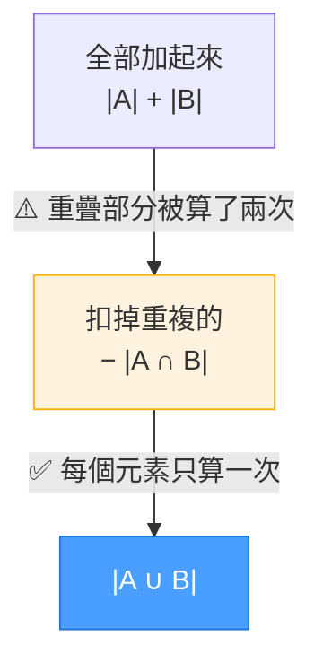
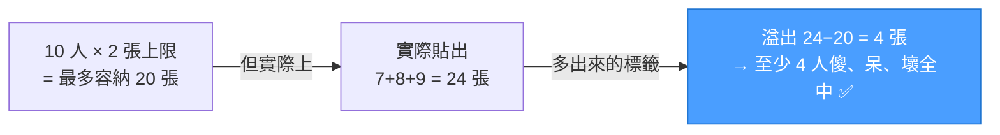
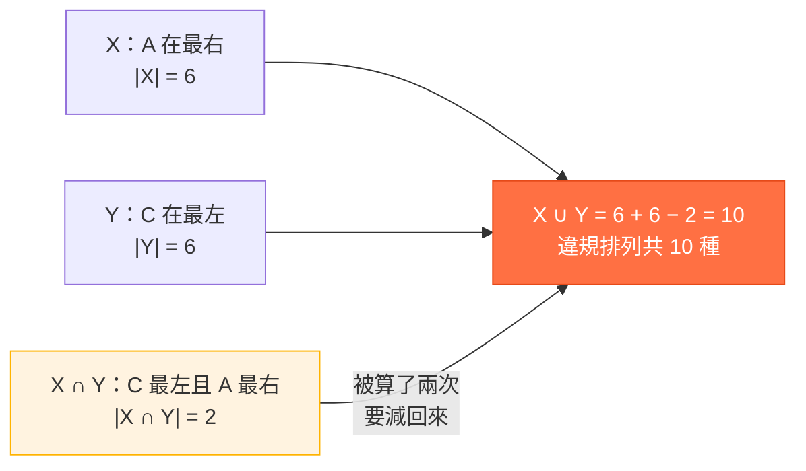



<!-- tab 排容-->

**排容定理**，也叫**容斥原理**，是在算「多個集合合起來有多少東西」時，用來處理**重複計算**的規則。

核心思想是：
> 先大方地把所有部分加起來，再把被重複計算到的部分減回來，讓每個元素最終只被計算一次。

可能會覺得：「不就是算集合重疊嗎？」

但它背後真正要解決的問題是：**如何避免重複計數（Double Counting）**

---

### 直觀理解

想像兩個集合 A 和 B 有重疊的部分，直接相加會把中間重疊的區域算兩次：

用公式表示就是：

$$|A \cup B| = |A| + |B| - |A \cap B|$$

這個「先加後減」的修正過程，就是**多退少補**的精髓。

<!-- endtab -->

<!-- tab 十個男人-->

**題目：** 十個男人七個傻、八個呆、九個壞，請問最少有幾個人傻又呆又壞？

這題的重點不是單純算聯集，而是在問：

> 三種標籤，最少有幾個人身上一定同時貼滿三張？

---

### 標籤模型

可以把每個人想成一個「貼標籤的容器」，每個人最多有三個標籤：**傻**、**呆**、**壞**

題目告訴我們總共貼出了：

$$7 + 8 + 9 = 24 \text{ 張標籤}$$

但如果沒有人三者全中，每個人最多只能拿 **2 張**標籤，10 個人最多只能容納：

$$10 \times 2 = 20 \text{ 張}$$

實際有 24 張，多出來的 $24 - 20 = 4$ 張，只能強迫 4 個人變成三重身份：

---

### 公式推導

這題對應排容定理的延伸不等式：

$$|A \cap B \cap C| \geq |A| + |B| + |C| - 2N$$

其中 $N$ 是總人數，代入數字：

$$|A \cap B \cap C| \geq 7 + 8 + 9 - 2 \times 10 = \boxed{4}$$

---

### 最大值是多少？

$x$ 不可能超過最小集合（傻的 7 人），而 $x = 7$ 確實可以構造出來：

| 人 | 傻 | 呆 | 壞 |
|---|:---:|:---:|:---:|
| 人 1 ～ 人 7 | ✅ | ✅ | ✅ |
| 人 8 | — | ✅ | ✅ |
| 人 9 | — | — | ✅ |
| 人 10 | — | — | — |

驗證：傻 $= 7$，呆 $= 7+1 = 8$，壞 $= 7+1+1 = 9$，完全符合 ✅

因此：

$$4 \leq x \leq 7$$

| 三重身份人數 $x$ | 是否可能 |
|:---:|:---:|
| 0 ～ 3 | ❌ |
| 4 ～ 7 | ✅ |
| 8 ～ 9 | ❌ |

- **下界 4**：由排容原理逼出的必然結果
- **上界 7**：三重交集不可能超過最小集合（傻的 7 人）

<!-- endtab -->

<!-- tab 字母排序-->

**題目：** 有 3 個位置，用 A、B、C、D 4 個字母進行排列，已知 **A 不能放最右邊**，且 **C 不能放最左邊**，請問總共有幾種不同的排法？

解法思路：

$$\text{合法排列數} = \text{全部排列數} - \text{違規排列數}$$

而「違規排列數」裡面有重疊，這正是排容原理出場的時機。

---

### Step 1：算全部排列

從 A、B、C、D 選 3 個做排列：

$$P(4,3) = 4 \times 3 \times 2 = 24 \text{ 種}$$

---

### Step 2：定義違規事件

令：
- $X$：A 在最右邊
- $Y$：C 在最左邊

題目要的是「$X$ 和 $Y$ 都不發生」的排列數，即：

$$\text{全部} - |X \cup Y|$$

---

### Step 3：分別計算違規數

**$|X|$：A 固定在最右邊** `_ _ A`

前兩格從 B、C、D 選兩個排列：$P(3,2) = 6$，故 $|X| = 6$

**$|Y|$：C 固定在最左邊** `C _ _`

後兩格從 A、B、D 選兩個排列：$P(3,2) = 6$，故 $|Y| = 6$

---

### Step 4：為什麼不能直接扣？

很多人直接寫：

$$24 - 6 - 6 = 12 \quad \textbf{❌ 這樣錯了}$$

因為有些排列**同時**滿足 $X$ 和 $Y$，例如 `C B A`、`C D A`，這些既屬於 $X$，也屬於 $Y$，直接扣兩次就**多扣了一次**。

---

### Step 5：用排容原理修正

$$|X \cup Y| = |X| + |Y| - |X \cap Y|$$

計算 $|X \cap Y|$：C 在最左、A 在最右，中間只能放 B 或 D `C _ A`，故 $|X \cap Y| = 2$

---

### 結論

$$\text{合法數量} = 24 - 10 = \boxed{14}$$

<!-- endtab -->

<!-- tab 求陰影部分的面積-->

**題目（英文原題）：**
> An isosceles right triangle has a side length of 10.
> A semicircle is drawn with a diameter of 10, and a circular arc is drawn with a radius of 10.
> Find the area of the **blue shaded region**.

---

### Step 1：把區域編號

圖中把整個圖切成四塊：

| 區域 | 說明 | 我們要的？ |
|:---:|---|:---:|
| ① | 上方藍色月牙 | ✅ |
| ② | 下方藍色月牙 | ✅ |
| ③ | 左側黑色區域 | — |
| ④ | 右側黑色區域 | — |

目標：求 $① + ②$（藍色總面積）

---

### Step 2：觀察三個大圖形

每個大圖形都是若干區域的組合：

| 圖形 | ① | ② | ③ | ④ |
|---|:---:|:---:|:---:|:---:|
| 半圓 | ✅ | ✅ | ✅ | — |
| 四分之一圓 | — | ✅ | — | ✅ |
| 直角三角形 | — | ✅ | ✅ | ✅ |

---

### Step 3：把半圓和四分之一圓相加

$$\text{半圓} + \text{四分之一圓} = (① + ② + ③) + (② + ④)$$

$$= ① + ② + ③ + ④$$

---

### Step 4：發現 ②+③+④ 就是三角形

$$② + ③ + ④ = \text{三角形}$$

代入上式：

$$① + 2② + ③ + ④ = ① + ② + (② + ③ + ④) = ① + ② + \text{三角形}$$

因此：

$$① + ② + \text{三角形} = \text{半圓} + \text{四分之一圓}$$

移項得到：

$$\boxed{① + ② = \text{半圓} + \text{四分之一圓} - \text{三角形}}$$

---

### Step 5：代入各圖形面積

- **半圓**（直徑 10，半徑 5）：

$$\frac{1}{2} \pi \cdot 5^2 = \frac{25\pi}{2}$$

- **四分之一圓**（半徑 10，圓心角 45°）：

$$\frac{45°}{360°} \times \pi \cdot 10^2 = \frac{25\pi}{2}$$

- **直角三角形**（兩股各 10）：

$$\frac{1}{2} \times 10 \times 10 = 50$$

---

### 結論

$$① + ② = \frac{25\pi}{2} + \frac{25\pi}{2} - 50 = \boxed{25\pi - 50} \approx 28.54$$

<!-- endtab -->

<!-- tab 排人-->

甲、乙、丙、……等 10 人排成一列

**(1)** 甲不排首，乙不排第二位，丙不排末位之排法有 ______ 種

**(2)** 甲、乙不排首，乙、丙、丁不排末位之排法有 ______ 種

---

### 核心思路

> 看到「某人不能排某位」，就轉成：全部 − 違規

$$\text{合法} = 10! - |A \cup B \cup C \cup \cdots|$$

容斥原理的修正邏輯：

$$|A \cup B \cup C| = |A|+|B|+|C| - |A \cap B| - |A \cap C| - |B \cap C| + |A \cap B \cap C|$$

---

### 第 (1) 題

定義違規事件：
- $A$：甲排第一位
- $B$：乙排第二位
- $C$：丙排最後一位

**全部排列**：$10!$

**單一違規**（固定一人後，其餘 9 人排列）：

$$|A| = |B| = |C| = 9!$$

**兩兩同時違規**（固定兩人後，其餘 8 人排列）：

| 交集 | 示意 | 數量 |
|---|---|---|
| $A \cap B$ | `甲 乙 _ _ _ _ _ _ _ _` | $8!$ |
| $A \cap C$ | `甲 _ _ _ _ _ _ _ _ 丙` | $8!$ |
| $B \cap C$ | `_ 乙 _ _ _ _ _ _ _ 丙` | $8!$ |

**三個都違規**：`甲 乙 _ _ _ _ _ _ _ 丙` → $7!$

**套入容斥**：

$$|A \cup B \cup C| = 3 \cdot 9! - 3 \cdot 8! + 7!$$

$$\text{答案} = 10! - (3 \cdot 9! - 3 \cdot 8! + 7!) = \boxed{2{,}656{,}080}$$

---

### 第 (2) 題

違規事件（共 5 個）：
- $A$：甲排第一位
- $B$：乙排第一位
- $C$：乙排最後位
- $D$：丙排最後位
- $E$：丁排最後位

**單一違規**：各為 $9!$，共 $5 \cdot 9!$

**兩兩交集**（先排除自動為空的）：

| 交集 | 為空？ | 原因 |
|---|:---:|---|
| $A \cap B$ | ✅ 空 | 甲乙不能同時排首 |
| $B \cap C$ | ✅ 空 | 乙不能同時排首和末 |
| $C \cap D$、$C \cap E$、$D \cap E$ | ✅ 空 | 末位只能有一人 |
| $A \cap C$、$A \cap D$、$A \cap E$、$B \cap D$、$B \cap E$ | ❌ 非空 | 不同人各佔一端 |

非空的兩兩交集共 **5 個**，每個都是 $8!$（固定首末各一人後排其餘 8 人）

**三重及以上交集**：任何三個事件中，必有兩個「末位事件」重疊或「首位事件」衝突，全部為 $\emptyset$

**套入容斥**：

$$|A \cup B \cup C \cup D \cup E| = 5 \cdot 9! - 5 \cdot 8!$$

$$\text{答案} = 10! - 5 \cdot 9! + 5 \cdot 8! = 50 \cdot 8! = \boxed{2{,}016{,}000}$$

---

### 如何一眼看出是容斥題？

看到以下字眼就要警覺：

| 題型 | 關鍵字 | 轉化方式 |
|---|---|---|
| **集合題** | 喜歡籃球／喜歡足球 | 直接套 $\|A \cup B\|$ |
| **排列限制題** | 甲不能在這位、乙不能在那位 | 全部 $-$ 違規聯集 |
| **機率題** | 至少一個成功／至少一個中獎 | $1 -$ 全部失敗的機率 |

核心轉換：「不能 A 且不能 B 且不能 C」= 全部 $-$ $(A \cup B \cup C)$

<!-- endtab -->

