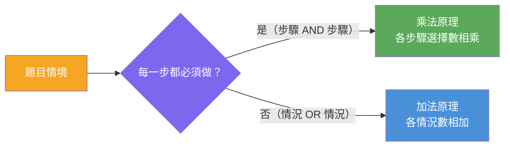
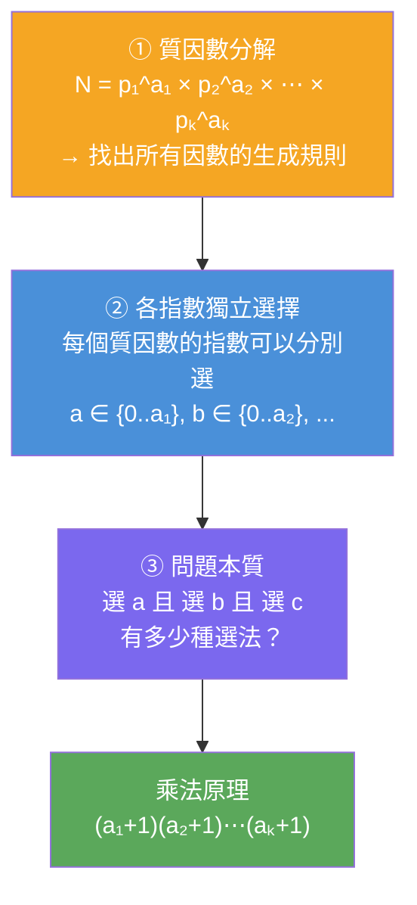




<!-- tab 使用乘法原理-->

**最重要的判斷方法：**

> 這件事是不是由好幾個步驟完成，而且每一步都必須做？
> 如果是，就很可能用乘法原理。




**乘法 vs 加法 對照**

| 情境 | 結構 | 原理 | 算法 |
|:---|:---|:---:|:---:|
| 先選衣服，再選褲子，再選鞋 | A **且** B **且** C | 乘法 | 3 × 2 × 4 = 24 |
| 搭公車有 3 種，或搭捷運有 4 種 | A **或** B | 加法 | 3 + 4 = 7 |

> **乘法原理**是在數「連續步驟的組合」；**加法原理**是在數「互斥情況的合併」


<!-- endtab -->


<!-- tab 360 正因數之和-->

因數個數公式的核心就是乘法原理。甚至可以說，因數個數公式根本就是乘法原理直接套用的結果


## 具體範例：360 的因數個數

以 **360 = 2³ × 3² × 5¹** 為例，任何因數都長成 **2ᵃ × 3ᵇ × 5ᶜ**，其中：

| 指數 | 可選範圍 | 選擇數 |
|:---:|:---|:---:|
| a（2 的指數） | 0, 1, 2, 3 | **4** 種 |
| b（3 的指數） | 0, 1, 2 | **3** 種 |
| c（5 的指數） | 0, 1 | **2** 種 |

現在問：**可以產生多少個不同因數？**

這其實是在問「選一個 a **且** 選一個 b **且** 選一個 c，有多少種選法？」正是乘法原理：

**4 × 3 × 2 = 24 個因數**

## 三層推導結構



以 360 代入：**(3+1)(2+1)(1+1) = 4 × 3 × 2 = 24**


<!-- endtab -->


<!-- tab 排列-->

## 密碼組合

假設一組密碼有 4 位數，每一位都可以是 0 到 9。

每一位有 10 種選擇，所以共有：**10 × 10 × 10 × 10 = 10⁴ = 10000 種密碼**


## 數字不能重複時

每選一位，剩餘可選數字就少一個：

| 位數 | 可選範圍 | 選擇數 |
|:---:|:---|:---:|
| 第 1 位 | 0–9 | 10 種 |
| 第 2 位 | 扣掉第 1 位 | 9 種 |
| 第 3 位 | 扣掉前兩位 | 8 種 |
| 第 4 位 | 扣掉前三位 | 7 種 |

**10 × 9 × 8 × 7 = 5040 種**

這就是**排列**的底層：每一步可選數遞減，但核心仍是乘法原理


<!-- endtab -->


<!-- tab 巢狀迴圈-->

```csharp
foreach (var shirt in shirts)           // 3 種
{
    foreach (var pants in pantsList)     // 2 種
    {
        foreach (var shoes in shoesList) // 4 種
        {
            count++;
        }
    }
}
```

總共跑幾次？**3 × 2 × 4 = 24**


| 迴圈層次 | 對應概念 | 選擇數 |
|:---:|:---|:---:|
| 最外層 | 第一步驟 | 3 |
| 中層 | 第二步驟 | 2 |
| 最內層 | 第三步驟 | 4 |
| **總執行次數** | **乘法原理** | **3 × 2 × 4 = 24** |

> 乘法原理其實就是：**巢狀迴圈的總組合數**


<!-- endtab -->


<!-- tab summary-->


<!-- endtab -->


