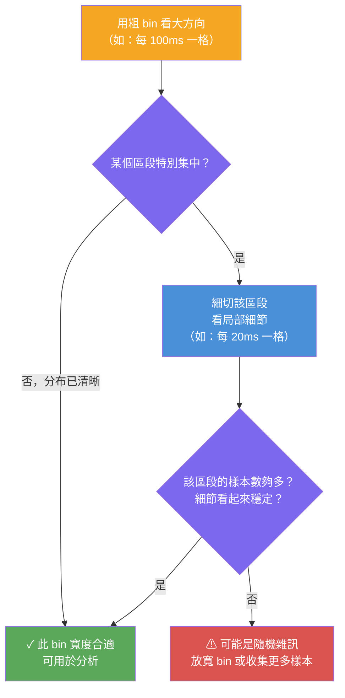



<!-- tab 本質-->

Histogram 是把一串連續數字切成一段一段區間，然後統計每個區間裡有幾筆資料。它的名字來自 Karl Pearson，常見解釋是由希臘語 histos（直立的柱、桅杆）加上 gramma（畫出來的東西、記錄）組成，意思可以理解成「用一根根直立柱子畫出來的統計圖」

Histogram 的本質是在把雜亂的數字資料切成可觀察的區間，讓你不用盯著每個數字，而是直接看出資料集中在哪裡、偏向哪裡、哪裡特別少。

**常見應用場景**

| 領域 | 典型資料欄位 |
|:---|:---|
| 電商 | 商品價格、訂單金額 |
| 教育 | 考試分數分布 |
| 後端工程 | API 請求延遲時間 |
| 產品分析 | 使用者年齡分布 |

<!-- endtab -->

<!-- tab 數字區間太寬-->

區間太寬會把重要細節抹平，讓原本有差異的資料看起來像沒差。bin 太寬的最大傷害是讓你**看不見資料真正的聚集位置**，誤以為分布均勻，其實裡面可能有好幾個明顯的群組

**例：考試分數 `60, 61, 62, 85, 86, 87, 98, 99`**

| 切法 | 區間結果 | 問題 |
|:---|:---|:---|
| **太寬**（每 50 分一格） | 0–50：0 筆 / 51–100：8 筆 | 三個聚集群（60s / 80s / 90s）全部被揉成一團 |
| **適當**（每 10 分一格） | 60–69：3 筆 / 80–89：3 筆 / 90–99：2 筆 | 清楚看出三個得分群 |

這種情況叫做 **oversmoothing**（平滑過頭）：資料的尖峰、斷層、異常群都可能被藏起來。

> bin width 控制「細節太多」和「細節太少」之間的取捨，是 histogram 最重要的參數之一

<!-- endtab -->

<!-- tab 數字區間太窄-->

區間太窄會讓圖變得很碎，雜訊被放大，真正的趨勢反而看不清楚。bin 太窄的最大傷害是讓你**把隨機波動誤認為真實規律**，做出錯誤的結論。

**範例：分數每 1 分切一格（樣本 8 筆）**

| 問題 | 說明 |
|:---|:---|
| 許多區間計數為 0 或 1 | 資料稀疏，圖形呈鋸齒狀 |
| 61 分：1 筆 / 62 分：1 筆 | 看起來像「61 是高峰」，但其實只是隨機 |
| 整體趨勢消失 | 真正的三個聚集群被雜訊淹沒 |

這種情況叫做 **overfitting the noise**：隨機雜訊被當成真實模式，整體分布反而更難辨認。

**寬 vs 窄的對比總結**

| | 區間太寬 | 區間太窄 |
|:---:|:---|:---|
| **術語** | Oversmoothing | Overfitting noise |
| **視覺效果** | 圖太平、缺乏細節 | 圖太碎、鋸齒狀 |
| **風險** | 遺漏真實聚集、異常 | 把雜訊誤認為趨勢 |

<!-- endtab -->

<!-- tab bin 要怎麼選-->

bin 的寬度是在問 **這個切法能不能讓我看見真正有用的分布？**

沒有一個永遠正確的 bin 數量；不同的 bin 寬度會讓你看到不同層次的資料特徵，實務上常常需要試幾種切法。

**實例：API 延遲時間分析**

| 步驟 | bin 寬度 | 目的 |
|:---:|:---|:---|
| 第一輪 | 100ms | 看出哪段延遲最集中（大方向）|
| 第二輪 | 20ms | 細切 0–100ms，看快速請求的分布細節 |
| 驗證 | — | 確認細節不是樣本太少造成的假象 |

<!-- endtab -->

