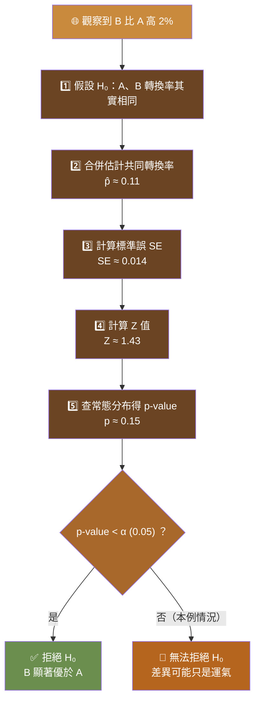



<!-- tab Ronald Fisher 的奶茶故事-->

假設檢定聽起來很硬，但它其實源自一個很生活化的小故事：**能不能用「猜對幾次」來判斷一個人是不是真的有某種能力，還是只是運氣好？** Ronald Fisher 用一杯奶茶的實驗，回答了這個問題，也順便發明了現代統計學最重要的工具之一。

  
Ronald Fisher 在一次聚會上，遇到了藻類生物學家 Muriel Bristol。

  
當 Fisher 正準備泡奶茶時，Bristol 突然開口說：

  

  
BRISTOL

  「我喝奶茶一定要先倒牛奶，再倒紅茶，這樣味道比較好。」
  

  
Fisher 聽了笑了：

  

  
FISHER

  「奶茶最後不就是牛奶和紅茶混在一起嗎？先倒茶還是先倒牛奶，怎麼可能喝得出差別勒？」
  

  
但 Bristol 非常有信心，她堅持自己真的能分辨兩種泡法。兩人誰也說服不了誰，於是 Fisher 提議：

  

  
FISHER

  「既然如此，我們就用實驗來證明吧！」
  

<!-- endtab -->

<!-- tab Fisher 如何設計這個實驗？-->

Fisher 沒有直接爭論對錯，而是設計了一個公平的實驗，讓「運氣」和「真本事」可以被量化區分開來。

  
實驗設計

  <ul>
    <li>準備 <code>8 杯</code>奶茶</li>
    <li><code>4 杯</code>是先倒茶，再倒牛奶</li>
    <li><code>4 杯</code>是先倒牛奶，再倒茶</li>
    <li>所有杯子外觀完全相同，Bristol 不可能靠顏色或外觀判斷，只能靠味道</li>
    <li>把 8 杯奶茶打亂順序，請 Bristol 挑出她認為「先倒茶」的 <code>4 杯</code></li>
  </ul>

  
問題來了

  如果 Bristol 真的沒有辨別能力，只是在亂猜，她猜中的機率是多少？

<!-- endtab -->

<!-- tab 先算亂猜有多少種可能-->

要回答「亂猜猜中的機率」，得先算出**全部有多少種挑法**，這是一個組合數學問題。

  
為什麼是 70 種？

  

Fisher 準備了 8 杯奶茶，其中 4 杯「先倒茶」、4 杯「先倒奶」。Bristol 的任務是從 8 杯裡<strong>挑出</strong>她認為是「先倒茶」的 4 杯。
  
關鍵在於她不是幫杯子排序，只是挑出一組 4 杯。所以 <code>{A, B, C, D}</code> 和 <code>{D, C, B, A}</code> 算<strong>同一種</strong>選法，這是「組合」問題，不是「排列」問題。

  

  
排列 vs 組合

  

  <table>
    <tr><th></th><th>排列</th><th>組合</th></tr>
    <tr><td>順序</td><td>有差</td><td>沒差</td></tr>
    <tr><td>舉例</td><td>從 8 杯選 4 杯並排名第一到第四</td><td>從 8 杯選出 4 杯（不管順序）</td></tr>
    <tr><td><code>{A,B,C,D}</code> vs <code>{D,C,B,A}</code></td><td>不同結果</td><td>相同結果</td></tr>
  </table>

奶茶實驗屬於組合，寫作 <code>C(8,4)</code>，意思是「從 8 杯裡不管順序挑出 4 杯」。
  

  
C(8,4) 怎麼算？

  

組合公式是：

$$C_n^r=\frac{n!}{r!\,(n-r)!}$$

代入 $n=8$、$r=4$：

$$C_8^4=\frac{8!}{4!\,4!}$$

把分子只保留比分母多的部分（約掉一個 $4!$）：

$$=\frac{8 \times 7 \times 6 \times 5}{4 \times 3 \times 2 \times 1}=\frac{1680}{24}=\boxed{70}$$

Bristol 從 8 杯裡挑出 4 杯，共有<strong>70 種</strong>可能選法。
  

  
全部猜對的機率

  如果 Bristol 完全沒有辨別能力，只是在隨機猜測，那麼<strong>全部猜對（4 杯都正確）</strong>只有 1 種可能，機率就是：

$$\frac{1}{70}\approx 1.4\%$$

  
猜對 3 杯的機率怎麼算？

  

真正「先倒茶」有 4 杯，真正「先倒奶」也有 4 杯。若猜對 3 杯，代表：
<ul>
  <li>從 4 杯真正先倒茶裡選中 3 杯：<code>C(4,3)=4</code> 種</li>
  <li>從 4 杯真正先倒奶裡誤選 1 杯：<code>C(4,1)=4</code> 種</li>
</ul>
兩段相乘：

$$C_4^3\times C_4^1=4\times 4=16$$

因此猜對 3 杯的機率是：

$$\frac{16}{70}\approx 22.86\%$$

  

<!-- endtab -->

<!-- tab 那猜對幾杯才算真的有能力？-->

如果只是猜對 1、2 杯，其實很容易靠運氣辦到；甚至猜對 3 杯以上的機率，加總起來大約也有 24%。換句話說，就算完全不會分辨，每四次左右也可能靠運氣成功一次，因此這個結果還不足以證明她真的有辨別能力。

如果 Fisher 將 5% 設為判斷標準（顯著性水準），就必須讓「只是靠運氣發生」的機率低於 5%。

  

  
全部猜中

  
1.4% ✅

  
小於 5%，足夠稀有

  

  

  
猜對 3 杯以上

  
24% ❌

  
大於 5%，不算稀有

  

  
結論

  只有 <strong>8 杯全部判斷正確</strong>，才能被認為證據足夠，支持 Bristol 確實具有辨別能力。

<!-- endtab -->

<!-- tab 這就是假設檢定的誕生-->

這個故事其實就是假設檢定（Hypothesis Testing）的起點，整個流程可以拆成 5 個步驟：

  
STEP 1提出零假設

  

Fisher 並沒有先相信 Bristol 能分辨。他先假設：<strong>Bristol 沒有辨別能力，她只是靠運氣在猜</strong>。這就是零假設（<code>Null Hypothesis</code>，<code>H₀</code>）。
  

  
STEP 2設計實驗

  

設計一個公平的實驗，排除外觀、提示等其他因素，只讓 Bristol 靠味道判斷。
  

  
STEP 3收集結果

  

紀錄 Bristol 最後猜對了幾杯。
  

  
STEP 4計算 p 值

  

假設零假設是真的，也就是 Bristol 其實沒有辨別能力。那麼，出現目前這個結果（或更極端結果）的機率是多少？這個機率就是 <code>p 值（p-value）</code>。
  

  
STEP 5與顯著性水準比較

  

通常會先設定顯著性水準 $\alpha=0.05$，也就是 5%。
<ul>
  <li>如果 <code>p 值 &lt; 0.05</code>，代表這種結果光靠運氣發生的機率非常低，因此我們<strong>拒絕零假設</strong></li>
  <li>如果 <code>p 值 ≥ 0.05</code>，代表這個結果仍有可能只是運氣造成，因此<strong>沒有足夠證據拒絕零假設</strong></li>
</ul>
  

<!-- endtab -->

<!-- tab 假設檢定在幹嘛?-->

當資料有隨機波動時，你需要一套方法判斷看到的差異，是運氣造成的，還是真的存在差異。每次做假設檢定，都可以先問自己這三個問題：

  
問題 1

  我先假設什麼？先假設「沒有效果、沒有差異」（<code>H0</code>）

  
問題 2

  如果這個假設是真的，現在看到的結果會常發生嗎？這正是 <code>p-value</code> 要回答的問題

  
問題 3

  如果很少發生（例如 <code>p &lt; 0.05</code>），我會怎麼想？我會認為：「這麼大的差異不像只是運氣造成，因此開始懷疑 <code>H0</code>，並拒絕 <code>H0</code>。」

<!-- endtab -->

<!-- tab 網頁轉換率-->

前面的奶茶故事只是暖身，實務上假設檢定最常見的應用是 **A/B Test**：兩個版本哪個轉換率真的比較好，還是只是抽樣運氣？

  
情境

  A 網頁轉換率 10%，B 網頁轉換率 12%。

  <table>
    <tr><th>網頁</th><th>樣本數</th><th>成功數</th><th>轉換率</th></tr>
    <tr><td>A</td><td>1000</td><td>100</td><td>10%</td></tr>
    <tr><td>B</td><td>1000</td><td>120</td><td>12%</td></tr>
  </table>

B 比 A 高 2%，但問題來了：是因為 B 真的比較好？還是只是這次剛好抽到比較會購買的使用者？只看數字，你不知道。假設檢定就是在回答這個問題。

## 整體流程一覽

  
本例結論

  本例中 <code>p-value ≈ 0.15 &gt; 0.05</code>，所以走向「無法拒絕 H₀」：目前證據不足以證明 B 真的比較好。

## 五個步驟，一步步算出 p-value

  
STEP 1假設兩個網頁其實沒有差異

  

這就是 <code>H₀</code>（虛無假設）：假設 A、B 真正的轉換率其實都一樣。也就是說如果讓更多人來測，兩者平均都會是同一個轉換率。那現在看到 A：10%、B：12%，只是抽樣運氣不同。
  

  
STEP 2估計共同轉換率

  

既然假設兩者一樣，最合理的方法就是把兩組資料合在一起估計：
<ul>
  <li>成功：100 + 120 = 220</li>
  <li>人數：1000 + 1000 = 2000</li>
</ul>
共同轉換率：

$$\hat{p} = \frac{220}{2000} = 0.11$$

意思就是如果 H₀ 成立，我們相信真正的轉換率應該大約是 11%。
  

  
STEP 3計算標準誤

  

如果真正都是 11%，1000 人一組，每組本來就可能上下波動，例如出現 10.4%、11.3%、11.8%、10.9% 等結果。這種波動大小叫做<strong>標準誤（Standard Error）</strong>：

$$SE = \sqrt{\hat{p}(1-\hat{p})\left(\frac{1}{n_A} + \frac{1}{n_B}\right)}$$

$$SE = \sqrt{0.11 \times 0.89 \times \left(\frac{1}{1000} + \frac{1}{1000}\right)} \approx 0.014$$

也就是如果其實沒有差異，兩組轉換率通常大概會差 1.4% 左右。
  

  
STEP 4目前差距有幾個標準誤

  

$12\% - 10\% = 2\%$，所以：

$$Z = \frac{0.02}{0.014} \approx 1.43$$

意思是我們看到的差距，大約是 1.43 個標準誤。
  

  
STEP 5把 Z 值換成 p-value

  

如果真的沒有差異，看到「至少這麼大的差距（2% 或更大）」的機率是多少？查標準常態分布，<code>Z = 1.43</code>，得到單尾機率約 0.076。如果做 A/B Test，通常會用雙尾：

$$p = 2 \times 0.076 \approx 0.152$$

所以 <strong>p-value ≈ 0.15</strong>。
  

  
p-value 代表什麼？

  意思是假設 A 和 B 根本沒有差異，那麼像這次一樣，看到 2% 或更大差距的機率，大約是 15%。因為這種情況其實不算罕見（15%），所以目前沒有足夠證據說 B 真的比較好。

  
15% 不算罕見嗎？

  「罕見」沒有一個自然的標準，而是統計學上人為訂一個門檻（顯著水準 <code>α</code>）。最常見的是 <code>α = 0.05</code>（5%），有些研究會用 1%（0.01），有些探索性研究可能用 10%（0.10）。
    
  如果 A 和 B 根本沒有差異，100 次實驗中，大約有 15 次會出現像這次一樣（或更大的）差距。15 次很多嗎？其實不少——想像你丟一顆骰子，擲出 6 的機率約為 $\frac{1}{6} \approx 16.7\%$。你會覺得「竟然擲出 6，一定有鬼！」嗎？不會，因為它並不稀有。15% 的事件，大概跟擲出 6 一樣常見，所以統計上通常不會因為 15% 就推翻原本的假設。

<!-- endtab -->


