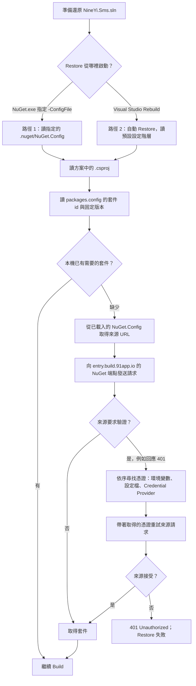




<!-- tab 專案建置-->

<!-- visual:start -->
<style>
#article-container .tabs{--nu-purple:#68217a;--nu-deep:#341042;--nu-cyan:#58c8e8;--nu-ink:#302438;--nu-muted:#63556b;--nu-soft:#f6f0f8;--nu-border:#e7d8ed;font-family:'Segoe UI','Microsoft JhengHei',sans-serif;color:var(--nu-ink);border:1px solid var(--nu-border);border-radius:22px;overflow:hidden;box-shadow:0 18px 50px rgba(67,24,79,.12)}
#article-container .tabs .nav-tabs{display:flex;flex-wrap:wrap;gap:7px;background:var(--nu-deep);padding:16px 18px;border:0}
#article-container .tabs .nav-tabs .tab{border:1px solid rgba(255,255,255,.2);background:rgba(255,255,255,.09);color:#fff!important;border-radius:999px;padding:8px 14px;font-size:.83rem;line-height:1.35;white-space:normal}
#article-container .tabs .nav-tabs .tab.active{background:var(--nu-cyan);border-color:var(--nu-cyan);color:#112b35!important;opacity:1!important;text-shadow:none!important;font-weight:800}
#article-container .tabs .tab-item-content{background:linear-gradient(150deg,#fff 0%,#fbf8fc 65%,#f4edf7 100%);padding:clamp(20px,4vw,42px)!important;color:var(--nu-ink)!important}
#article-container .tabs .tab-item-content>p{max-width:72ch;line-height:1.9;margin:18px 0 24px;color:var(--nu-ink)!important;font-size:1rem}
#article-container .tabs .tab-item-content>p strong{color:var(--nu-purple)!important}
#article-container .tabs .tab-item-content h2{color:var(--nu-purple)!important;font-size:1.3rem;margin:38px 0 18px;padding:0 0 0 15px;border-left:5px solid var(--nu-cyan)}
#article-container .tabs .tab-item-content :not(pre)>code{background:#f0e6f4!important;border:1px solid #e4d3eb;color:#6a277c!important;padding:2px 5px;border-radius:5px;overflow-wrap:anywhere}
#article-container .tabs .tab-item-content>table{width:auto;max-width:100%;display:table;margin:16px 0 28px;border-collapse:separate;border-spacing:0;border:1px solid var(--nu-border);border-radius:13px;overflow:hidden;background:#fff;box-shadow:0 8px 24px rgba(54,19,67,.06)}
#article-container .tabs .tab-item-content>table th{background:#efe1f4!important;color:#4c165d!important;font-weight:800}
#article-container .tabs .tab-item-content>table td{background:#fff!important;color:var(--nu-ink)!important;vertical-align:top}
#article-container .tabs .tab-item-content>table tr:hover td{background:#fbf7fc!important}
#article-container .tabs .tab-item-content>ol{counter-reset:nu-step;list-style:none;padding:0 0 0 15px;margin:22px 0 34px;border-left:2px solid #d8c0e2}
#article-container .tabs .tab-item-content>ol>li{counter-increment:nu-step;position:relative;margin:0 0 14px 22px;padding:15px 18px 15px 20px;background:#fff;border:1px solid var(--nu-border);border-radius:13px;line-height:1.75;box-shadow:0 6px 19px rgba(54,19,67,.05)}
#article-container .tabs .tab-item-content>ol>li:before{content:counter(nu-step);position:absolute;left:-50px;top:14px;display:grid;place-items:center;width:28px;height:28px;border-radius:50%;background:var(--nu-purple);color:#fff;font-weight:800;font-size:.8rem}
#article-container .tabs .tab-item-content figure.highlight{border-radius:16px;overflow:auto;border:1px solid #4b275a;box-shadow:0 13px 30px rgba(37,15,48,.16);margin:18px 0 28px}
#article-container .tabs .tab-item-content figure.highlight table{margin:0!important;max-width:none!important;width:100%!important}
#article-container .tabs .tab-item-content figure.highlight pre{line-height:1.65}
#article-container .tabs .tab-item-content pre:has(>code.highlight.mermaid){display:none}
.nu-band{position:relative;overflow:hidden;background:var(--nu-purple);color:#fff!important;border-radius:20px;padding:28px 34px;margin:0 0 28px;min-height:136px;box-shadow:0 18px 36px rgba(104,33,122,.2)}
.nu-band:before{content:'';position:absolute;right:35px;top:-37px;width:180px;height:180px;border:12px solid rgba(255,255,255,.74);border-radius:50%}
.nu-band:after{content:'';position:absolute;right:99px;top:34px;width:30px;height:30px;background:var(--nu-cyan);border-radius:50%;box-shadow:0 0 0 10px rgba(88,200,232,.12)}
.nu-band .nu-kicker{font-size:.68rem;font-weight:800;letter-spacing:.17em;text-transform:uppercase;color:#cfeef8!important;position:relative;z-index:1}
.nu-band .nu-title{display:block;position:relative;z-index:1;max-width:70%;font-size:clamp(1.25rem,2.7vw,1.8rem);font-weight:800;line-height:1.35;margin:7px 0 0;color:#fff!important}
.nu-band .nu-sub{display:block;position:relative;z-index:1;max-width:72%;margin-top:7px;color:#eee2f2!important;font-size:.9rem;line-height:1.55}
.nu-map{display:grid;grid-template-columns:repeat(3,minmax(0,1fr));gap:14px;margin:22px 0 30px;align-items:stretch}
.nu-map.two{grid-template-columns:repeat(2,minmax(0,1fr))}
.nu-tile{position:relative;background:#fff;border:1px solid var(--nu-border);border-radius:16px;padding:21px 18px 18px;box-shadow:0 8px 22px rgba(54,19,67,.06);min-width:0}
.nu-tile:before{content:'';position:absolute;top:0;left:18px;right:18px;height:4px;border-radius:0 0 4px 4px;background:var(--nu-purple)}
.nu-tile.cyan:before{background:var(--nu-cyan)}
.nu-tile .nu-mark{display:grid;place-items:center;width:39px;height:39px;border-radius:12px;background:#efe1f4;color:var(--nu-purple)!important;font-size:1.35rem;font-weight:800;margin-bottom:12px}
.nu-tile.cyan .nu-mark{background:#e0f7fc;color:#146d88!important}
.nu-tile strong{display:block;color:var(--nu-deep)!important;font-size:1rem;line-height:1.35;margin-bottom:7px}
.nu-tile small{display:block;color:var(--nu-muted)!important;font-size:.82rem;line-height:1.65}
.nu-tile code,.nu-track code,.nu-ladder code{overflow-wrap:anywhere;font-size:.8em}
.nu-track{display:flex;align-items:center;gap:10px;margin:22px 0 30px;overflow-x:auto;padding:5px 2px 14px}
.nu-track .nu-stop{flex:1 0 145px;min-width:145px;text-align:center;background:#fff;border:1px solid var(--nu-border);border-radius:15px;padding:16px 13px;color:var(--nu-deep)!important;font-weight:800;box-shadow:0 7px 20px rgba(54,19,67,.06)}
.nu-track .nu-stop .nu-orb{display:block;margin:0 auto 9px;width:27px;height:27px;border:5px solid var(--nu-purple);border-radius:50%;position:relative}
.nu-track .nu-stop .nu-orb:after{content:'';position:absolute;width:8px;height:8px;border-radius:50%;background:var(--nu-cyan);left:5px;top:5px}
.nu-track .nu-arr{flex:none;color:var(--nu-purple)!important;font-size:1.5rem;font-weight:800}
.nu-branch{display:grid;grid-template-columns:1fr 1fr;gap:16px;margin:20px 0 28px}
.nu-lane{background:#fff;border:1px solid var(--nu-border);border-radius:17px;padding:18px 20px;box-shadow:0 8px 25px rgba(54,19,67,.06)}
.nu-lane .nu-label{display:inline-block;background:#e8f8fc;color:#116f88!important;border-radius:999px;padding:4px 10px;font-size:.68rem;font-weight:800;letter-spacing:.08em;margin-bottom:10px}
.nu-lane.purple .nu-label{background:#f0e5f4;color:var(--nu-purple)!important}
.nu-lane strong{display:block;color:var(--nu-deep)!important;font-size:1rem;margin-bottom:8px}
.nu-lane p{font-size:.86rem!important;line-height:1.7!important;color:var(--nu-muted)!important;margin:0!important}
.nu-merge{text-align:center;color:var(--nu-purple)!important;font-weight:900;font-size:1.2rem;margin:-10px 0 8px}
.nu-ladder{margin:22px 0 30px;border-left:3px solid #ddc8e5;padding-left:26px}
.nu-rung{position:relative;background:#fff;border:1px solid var(--nu-border);border-radius:12px;padding:13px 16px;margin:0 0 11px;color:var(--nu-ink)!important;line-height:1.6}
.nu-rung:before{content:'';position:absolute;left:-35px;top:18px;width:14px;height:14px;border:4px solid var(--nu-purple);border-radius:50%;background:#fff}
.nu-rung.muted{background:#f6f1f7;color:var(--nu-muted)!important;border-style:dashed}
.nu-rung.muted:before{border-color:#b7a3bf}
.nu-rung strong{color:var(--nu-deep)!important}
.nu-tip{background:#effaff;border:1px solid #b8ebf7;border-left:4px solid var(--nu-cyan);border-radius:12px;padding:16px 19px;margin:20px 0 28px;color:var(--nu-deep)!important;line-height:1.7}
.nu-tip.warning{background:#fff7eb;border-color:#f1d8aa;border-left-color:#c88022}
@media(max-width:740px){ #article-container .tabs .nav-tabs{padding:12px;gap:6px}#article-container .tabs .nav-tabs .tab{font-size:.72rem;padding:8px 10px}#article-container .tabs .tab-item-content{padding:20px!important}#article-container .tabs .tab-item-content>table{display:block;overflow-x:auto} .nu-band{padding:23px 22px}.nu-band:before{right:-66px;opacity:.48}.nu-band:after{right:4px;opacity:.8}.nu-band .nu-title,.nu-band .nu-sub{max-width:92%}.nu-map,.nu-map.two,.nu-branch{grid-template-columns:1fr}.nu-track{gap:7px}.nu-track .nu-stop{flex-basis:125px;min-width:125px}}
</style>
<!-- visual:end -->


<!-- visual:start -->
<div class="nu-band"><span class="nu-kicker">.NET / RESTORE</span><strong class="nu-title">從 Rebuild 走到 DLL</strong><span class="nu-sub">先找齊套件，編譯才有材料可用。</span></div>
<!-- visual:end -->


故事從一次再普通不過的 `Rebuild` 開始。Visual Studio 收到指令，準備重新建置整個方案，`MSBuild` 還沒開始編譯，NuGet 卻先發現一件更急的事，專案要用的套件，電腦裡真的都有嗎？少了套件，後面的編譯連 DLL 都找不到。

於是 Visual Studio 內建的 NuGet 功能先接下方案建置事件，嘗試自動 Restore。NuGet 公開實作中，處理這個事件的元件叫 `SolutionRestoreBuildHandler`

<!-- visual:start -->
<div class="nu-track" role="img" aria-label="Rebuild 觸發 NuGet Restore，再由 MSBuild 編譯"><div class="nu-stop"><span class="nu-orb"></span>Visual Studio<br><code>Rebuild</code></div><span class="nu-arr">→</span><div class="nu-stop"><span class="nu-orb"></span>NuGet<br><code>Restore</code></div><span class="nu-arr">→</span><div class="nu-stop"><span class="nu-orb"></span><code>MSBuild</code><br>編譯</div></div>
<!-- visual:end -->


如果不從 Visual Studio 按下 `Rebuild`，而是走命令列，同一件事可以直接交給 `NuGet.exe`

```bash
& '.nuget\NuGet.exe' restore 'NineYi.Sms.sln' -PackagesDirectory 'packages' -ConfigFile '.nuget\NuGet.Config' -NonInteractive
```

接下來，NuGet 得像查名冊一樣，把「到底缺誰」查清楚。以 SMS 方案為例，它先翻開 `NineYi.Sms.sln`，找到方案裡的 `.csproj`，再走進各專案的 `packages.config`。這份清單寫得很具體：`id` 是套件名稱，`version` 是**確切版本**，`targetFramework` 則記錄套件安裝時對應的目標框架


例如，`CrossLayer\Modules\packages.config` 裡就有這兩筆

```xml
<package id="NineYi.Common.Utility.Ad.Client" version="2.2611.306.422" targetFramework="net472" />
<package id="NineYi.Scm.Api.ClientV2" version="1.2611.315.1220-alpha" targetFramework="net472" />
```


<!-- visual:start -->
<div class="nu-map" role="group" aria-label="三份設定的分工"><div class="nu-tile"><span class="nu-mark">≡</span><strong><code>packages.config</code></strong><small>套件的 <code>id</code> 與確切 <code>version</code></small></div><div class="nu-tile cyan"><span class="nu-mark">↗</span><strong><code>NuGet.Config</code></strong><small>來源 URL 與憑證設定</small></div><div class="nu-tile"><span class="nu-mark">⌁</span><strong><code>HintPath</code></strong><small>編譯時找到套件中的 DLL</small></div></div>
<!-- visual:end -->

注意第二筆那串長長的 `1.2611.315.1220-alpha`。它是專案早就在 `packages.config` 裡寫好的版本。NuGet 拿著 `id` 和 `version` 檢查本機；真的缺了，才去設定的來源查詢、下載


知道要找哪個版本，還得知道去哪裡找。這時登場的是 `NuGet.Config`，裡面有套件來源的 URL 和憑證設定。不過，兩種入口拿到的設定未必相同：上面的命令用 `-ConfigFile '.nuget\NuGet.Config'` 指定檔案；Visual Studio 的 `Rebuild` 則依預設設定階層載入。命令中的 `-PackagesDirectory 'packages'` 還交代了另一件事：找到的套件要放進 `packages` 資料夾


從方案一路追到 DLL，路線長這樣

```bash
NineYi.Sms.sln
  → CrossLayer\Modules\NineYi.Sms.Modules.csproj
  → CrossLayer\Modules\packages.config（列出套件 id 與版本）
  → 依 NuGet.Config 的來源 URL 查找缺少的套件
  → C:\91APP\NineYi.Sms\packages\套件名稱.版本\
  → .csproj 的 HintPath 指向其中的 DLL，供 Build 使用
```


## 套件找回來了，DLL 藏在哪裡？

套件下載到 `packages`，事情還沒結束。`MSBuild` 不會憑空知道 DLL 藏在哪一層資料夾，它要看 `.csproj` 裡的 `Reference` 和 `HintPath`。在 `CrossLayer\Modules\NineYi.Sms.Modules.csproj` 第 358–360 行，就能找到 `NineYi.Scm.Api.ClientV2` 的路標


```xml
<Reference Include="NineYi.Scm.Api.Client.V2, Version=1.2611.315.1220, Culture=neutral, processorArchitecture=MSIL">
  <HintPath>..\..\packages\NineYi.Scm.Api.ClientV2.1.2611.315.1220-alpha\lib\NineYi.Scm.Api.Client.V2.dll</HintPath>
</Reference>
```

沿著這條 `HintPath` 走一次，從 `.csproj` 所在的 `C:\91APP\NineYi.Sms\CrossLayer\Modules` 出發，`..\..` 先退回方案根目錄，接著進入 `packages`，最後抵達 `C:\91APP\NineYi.Sms\packages\NineYi.Scm.Api.ClientV2.1.2611.315.1220-alpha\lib\NineYi.Scm.Api.Client.V2.dll`。先前在本機檢查時，這個 DLL 確實存在


這也把兩份檔案的工作分清楚了：`packages.config` 的 `id/version` 指定 Restore 要找哪個 **NuGet 套件**；`.csproj` 的 `Reference/HintPath` 告訴 Build，那個套件裡的 **DLL 究竟放在哪裡**


<!-- endtab -->


<!-- tab 鏈路-->

<!-- visual:start -->
<div class="nu-band"><span class="nu-kicker">THE ROUTE</span><strong class="nu-title">兩個入口，一道驗證關卡</strong><span class="nu-sub">啟動方式與憑證來源，是兩個不同問題。</span></div>
<!-- visual:end -->


剛才我們已經找到套件和 DLL。現在把鏡頭往回拉，看 NuGet 走到套件來源前，究竟經過哪些岔路。整段流程有兩個關鍵問題：**誰叫醒了 Restore？來源要帳密時，又由誰交出憑證？**


<!-- visual:start -->
<div class="nu-branch" role="group" aria-label="Restore 的兩種入口"><div class="nu-lane purple"><span class="nu-label">入口 1</span><strong><code>NuGet.exe</code></strong><p><code>-ConfigFile</code> 指定專案內的設定檔。</p></div><div class="nu-lane"><span class="nu-label">入口 2</span><strong>Visual Studio <code>Rebuild</code></strong><p>自動 Restore，依預設設定階層讀取。</p></div></div><div class="nu-merge">↓　共同讀取方案與 <code>packages.config</code>　↓</div><div class="nu-branch" role="group" aria-label="本機套件檢查的兩種結果"><div class="nu-lane"><span class="nu-label">已有套件</span><strong>直接繼續 Build</strong><p>不必向來源請求。</p></div><div class="nu-lane purple"><span class="nu-label">缺少套件</span><strong>向來源 URL 查詢</strong><p>來源若要求驗證，再尋找憑證。</p></div></div><div class="nu-merge">↓　缺少套件時，來源請求的結果　↓</div><div class="nu-branch"><div class="nu-lane"><span class="nu-label">來源接受</span><strong>取得套件，繼續 Build</strong><p>取得所需版本後，編譯才有 DLL 可用。</p></div><div class="nu-lane purple"><span class="nu-label">來源回應 401</span><strong>依序尋找憑證</strong><p>環境變數、設定檔帳密，最後才可能詢問 Credential Provider。</p></div></div>
<!-- visual:end -->



圖的上半段是入口，命令列和 Visual Studio 都會讀方案與套件清單，但取得設定檔的方式不同，下半段才是驗證：套件不在本機、需要向來源請求時，來源才有機會要求帳密。

因此，後文雖然稱為「路徑 1、2、3」，它們不是三個互斥選項

**路徑 1、2** 是誰啟動 Restore
**路徑 3** 的 Credential Provider 是驗證時可能登場的憑證插件

無論從命令列還是 Visual Studio 進來，都可能走到它，也可能完全用不上，這段路上有幾個容易混在一起的名字，先對好位置


| 名詞 | 在本案例中的意思 |
|---|---|
| `entry.build.91app.io` | 公司內部 NuGet 來源的主機名稱。NuGet 會對它底下的 `/repository/...` URL 發出 HTTP 請求，並非只做一次「登入」。 |
| Package source／feed | 查詢套件中繼資料、版本及下載 `.nupkg` 的來源 URL。`NineYi.Nuget.Release` 這類名稱則是本機設定使用的識別鍵。 |
| `NuGet.Config` | 記載來源名稱、URL、來源帳密與其他 NuGet 選項的 XML 設定檔。不同啟動方式可能讀到不同檔案。 |
| HTTP 401 | 套件來源要求驗證或拒絕目前的憑證。第一次未帶憑證的請求收到 401，可能只是正常的驗證挑戰；重試後仍被拒絕，Restore 才會失敗。 |
| HTTP 407 | 要求驗證的是代理伺服器（proxy），不是回應 401 的套件來源。 |
| `-NonInteractive` | Restore 不停下來等待使用者輸入；設定檔、環境變數或能以非互動方式工作的 Provider 仍可交出憑證。 |


收到 401 時，可以把它想成來源在門口問：「憑證呢？」NuGet 不是立刻放棄，而是按順序查看三個地方

| 順序 | 機制 | 對應條件 |
|---|---|---|
| 1 | `NuGetPackageSourceCredentials_{來源名稱}` 環境變數 | 名稱要與已載入的 package source key 相符。 |
| 2 | 已載入的 `NuGet.Config` 中的來源帳密 | 帳密要對應到該來源名稱。 |
| 3 | Credential Provider | 前面沒有取得可用憑證時，詢問能處理該來源的插件。 |

第一次 401 只是問說 **帶著憑證重試後仍被拒絕**，才是這次 Restore 真正走不下去的訊號

<!-- endtab -->


<!-- tab 路徑 1：命令列明確指定 .nuget\NuGet.Config-->

<!-- visual:start -->
<div class="nu-band"><span class="nu-kicker">PATH 01 / CLI</span><strong class="nu-title">這條路，設定檔由命令指定</strong><span class="nu-sub">一行指令把方案、來源、位置與互動方式說清楚。</span></div>
<!-- visual:end -->


這次不按 Visual Studio 的 `Rebuild`，而是在 `C:\91APP\NineYi.Sms` 親自下指令。命令看起來很長，其實是在把幾件事交代清楚：**照哪份方案找套件、用哪份設定找來源、下載後放哪裡，以及過程中能不能停下來問帳密。**


```bash
& '.nuget\NuGet.exe' restore 'NineYi.Sms.sln' -PackagesDirectory 'packages' -ConfigFile '.nuget\NuGet.Config' -NonInteractive
```


拆開看，每一段都有工作

<!-- visual:start -->
<div class="nu-track" role="img" aria-label="命令列 Restore 依方案、設定檔與套件目錄執行"><div class="nu-stop"><span class="nu-orb"></span><code>NuGet.exe</code></div><span class="nu-arr">→</span><div class="nu-stop"><span class="nu-orb"></span><code>.sln</code></div><span class="nu-arr">→</span><div class="nu-stop"><span class="nu-orb"></span><code>NuGet.Config</code></div><span class="nu-arr">→</span><div class="nu-stop"><span class="nu-orb"></span><code>packages</code></div></div>
<!-- visual:end -->


| 命令片段 | 交代給 NuGet 的事 |
|---|---|
| `.nuget\NuGet.exe` | 使用方案附帶的 NuGet 命令列工具。 |
| `restore 'NineYi.Sms.sln'` | 從這份方案出發，還原其中專案需要的套件。 |
| `-PackagesDirectory 'packages'` | 把 `packages.config` 專案的套件放進 SMS 方案的 `packages` 目錄。 |
| `-ConfigFile '.nuget\NuGet.Config'` | **只讀指定檔案中的設定**，不合併使用者或上層資料夾的 `NuGet.Config`。 |
| `-NonInteractive` | 執行途中不等待使用者輸入帳密。 |


## 指令送出後，NuGet 做了什麼？

1. **先查名單。** NuGet 打開 `NineYi.Sms.sln`，找到方案裡的專案，再讀各專案的 `packages.config`。其中的 `id` 和 `version` 已把套件名稱與確切版本寫明，NuGet 不必猜。
2. **再找地址。** 因為命令帶了 `-ConfigFile`，NuGet 只載入 `C:\91APP\NineYi.Sms\.nuget\NuGet.Config`。這份檔案列有 `NineYi.Nuget.Release`、`NineYi.Nuget.Develop`、`NineYi.Nuget.Group` 三個來源。
3. **先看手邊有沒有。** NuGet 檢查本機套件與快取；需要向來源查詢時，才對相應的 `entry.build.91app.io/repository/...` URL 發送 HTTP 請求。
4. **遇到驗證，再拿憑證。** 若來源要求驗證，NuGet 依前一個 tab 的順序尋找憑證。這次指定的設定檔裡已有來源帳密，不需要把 Credential Provider 當成成功的理由。
5. **套件到位，Restore 收工。** 來源接受請求後，NuGet 取得缺少的套件，放進 `packages`。接下來，Build 才能沿著 `.csproj` 的 `HintPath` 找到 DLL。


<!-- endtab -->


<!-- tab 路徑 2：Visual Studio 執行 Rebuild-->

<!-- visual:start -->
<div class="nu-band"><span class="nu-kicker">PATH 02 / VISUAL STUDIO</span><strong class="nu-title">VS Restore 走哪份設定？</strong><span class="nu-sub">Solution Item 看得見，不代表預設搜尋會讀到。</span></div>
<!-- visual:end -->


同樣是還原套件，換成 Visual Studio 按下 `Rebuild`，走的卻不是上一個 tab 那條命令。開啟 `NineYi.Sms.sln` 後，VS 發現缺少套件，就會先觸發 NuGet 自動 Restore，再讓建置繼續。

它**不會把命令列的 `-ConfigFile` 偷偷帶進來**。入口換了，NuGet 手上的設定檔也可能跟著換。

## 那份 `NuGet.Config`，VS 真的會讀嗎？

命令列有 `-ConfigFile`，等於指定「就看這一份」。VS 沒有這個參數時，NuGet 依設定階層尋找：電腦層級、使用者層級，以及從磁碟根目錄一路到方案目錄的 `NuGet.Config`。越靠近方案的同名設定可以覆蓋上層設定，來源清單也可能合併。

這裡藏著一個容易漏看的轉折：從 NuGet 3.4 起，檔案放在方案底下的 `.nuget` 目錄，**不會因此自動成為方案層級設定**。`NineYi.Sms.sln` 雖然把 `.nuget\NuGet.Config` 列為 Solution Item，那只代表它會出現在方案裡；看得到檔案，不等於 Restore 會讀它。


<!-- visual:start -->
<div class="nu-ladder" role="img" aria-label="Visual Studio 依設定階層搜尋 NuGet.Config"><div class="nu-rung"><strong>電腦層級</strong>　<code>C:\NuGet.Config</code></div><div class="nu-rung"><strong>使用者層級</strong>　<code>%APPDATA%\NuGet\NuGet.Config</code></div><div class="nu-rung"><strong>上層到方案根目錄</strong>　越靠近方案的同名設定可以覆蓋上層。</div><div class="nu-rung muted"><strong><code>.nuget\NuGet.Config</code></strong>　不會只因列為 Solution Item 就自動載入。</div></div>
<!-- visual:end -->

先前本機檢查時，各處設定長這樣

| 位置 | 當時看到什麼 | 對 VS 預設 Restore 的意義 |
|---|---|---|
| `C:\91APP\NineYi.Sms\.nuget\NuGet.Config` | `NineYi.Nuget.*` 三個私有來源及帳密 | 命令列指定 `-ConfigFile` 會用到；預設搜尋不會只因它位於 `.nuget` 子目錄就載入。 |
| `C:\91APP\NineYi.Sms\NuGet.Config` | 檔案不存在 | 方案根目錄沒有這份設定可覆蓋使用者設定。 |
| `C:\91APP\NuGet.Config`、`C:\NuGet.Config` | 有 `nuget.org` 來源 | 這兩份屬於上層設定。 |
| `%APPDATA%\NuGet\NuGet.Config` | `Nine1.Nuget.*` 三個私有來源及帳密 | 依預設搜尋規則，VS 的 Restore 應會讀取這份使用者設定。這是根據設定推得的路徑，不是這次實測的 VS Restore 紀錄。 |

兩份私有來源設定看起來相似，細看卻不是同一份。本機比對過 Release、Develop、Group 的帳號與密碼內容，兩邊一致；本文不記錄密碼。但來源 key 不同，Group 的 URL 也不同：

| 類別 | 命令列明確指定的檔案 | 使用者層級檔案 |
|---|---|---|
| Release key | `NineYi.Nuget.Release` | `Nine1.Nuget.Release` |
| Develop key | `NineYi.Nuget.Develop` | `Nine1.Nuget.Develop` |
| Group URL | `/repository/nineyi-release-nuget/index.json` | `/repository/nineyi-release-nuget-hosted/index.json` |

所以，「命令列 Restore 成功」不能直接當成「VS 一定讀了同一份設定檔」的證據。兩邊入口不同，來源 key 與 Group URL 也確實不同。

## VS 什麼時候會跳出帳密視窗？

若來源要求驗證，VS 的 NuGet 驗證服務可能先從設定檔取憑證，再向 VS 的 Credential Provider 或跨平台 NuGet 插件詢問。若仍拿不到可用憑證，才可能出現基本驗證視窗。視窗何時出現、插件何時被呼叫，會隨 VS 與 NuGet 版本而變；這裡不能把某一次彈窗當成所有版本的固定流程。

<!-- endtab -->


<!-- tab 路徑 3：Azure Artifacts Credential Provider-->

<!-- visual:start -->
<div class="nu-band"><span class="nu-kicker">PATH 03 / CREDENTIALS</span><strong class="nu-title">Provider 交的是憑證</strong><span class="nu-sub">只有來源需要驗證，前面又沒有可用憑證時，插件才可能登場。</span></div>
<!-- visual:end -->


最後來看那位常被誤認成「第三個套件來源」的角色：Credential Provider。它其實**不提供套件，只提供憑證**。

NuGet 要向受保護的來源拿套件，前面又沒有取得可用帳密時，才可能問插件：「這個來源 URL 該用哪組憑證？」插件回答後，重試請求的仍是 NuGet。

公司文件使用 Microsoft 的 Azure Artifacts Credential Provider，並要求安裝支援 .NET Framework 工具的版本（`-AddNetfx`），因為 SMS 使用的 `NuGet.exe` 需要這種支援。文件還要求設定使用者環境變數 `VSS_NUGET_EXTERNAL_FEED_ENDPOINTS`，以 JSON 列出來源 endpoint、username 和 password。這份資料是交給 **Provider** 查的，不是 NuGet 自己讀取的來源專用環境變數。

兩個名字很像，讀取它們的角色卻不同：

<!-- visual:start -->
<div class="nu-branch" role="group" aria-label="兩種環境變數由不同元件讀取"><div class="nu-lane purple"><span class="nu-label">NUGET 原生</span><strong><code>NuGetPackageSourceCredentials_*</code></strong><p>NuGet 依來源 key 取得憑證。</p></div><div class="nu-lane"><span class="nu-label">PROVIDER 輸入</span><strong><code>VSS_NUGET_EXTERNAL_FEED_ENDPOINTS</code></strong><p>Provider 依 endpoint 找對應憑證。</p></div></div>
<!-- visual:end -->


| 環境變數 | 誰使用它 |
|---|---|
| `NuGetPackageSourceCredentials_{來源名稱}` | NuGet 原生的來源憑證機制，名稱要對上已載入的來源 key。 |
| `VSS_NUGET_EXTERNAL_FEED_ENDPOINTS` | Azure Artifacts Credential Provider 讀取的 endpoint 與憑證對應表。 |

Microsoft Provider 現在把 `VSS_NUGET_EXTERNAL_FEED_ENDPOINTS` 視為舊名稱，偏好的新名稱是 `ARTIFACTS_CREDENTIALPROVIDER_EXTERNAL_FEED_ENDPOINTS`；公司文件沿用的舊名稱仍受支援。

## Provider 真正登場時，順序是什麼？

<!-- visual:start -->
<div class="nu-track" role="img" aria-label="NuGet 向來源請求，Provider 回傳憑證，NuGet 重試"><div class="nu-stop"><span class="nu-orb"></span>NuGet<br>請求來源</div><span class="nu-arr">→</span><div class="nu-stop"><span class="nu-orb"></span>來源<br><code>401</code></div><span class="nu-arr">→</span><div class="nu-stop"><span class="nu-orb"></span>Provider<br>交付憑證</div><span class="nu-arr">→</span><div class="nu-stop"><span class="nu-orb"></span>NuGet<br>重試</div></div>
<!-- visual:end -->


1. NuGet 從已載入的 `NuGet.Config` 找到來源 URL，向來源查詢或下載套件。
2. 來源要求驗證時，NuGet 先查來源專用環境變數與設定檔帳密。
3. 前面沒有取得可用憑證，才輪到 Provider。NuGet 呼叫插件，告訴它正在存取哪個來源 URL。
4. Provider 從 `VSS_NUGET_EXTERNAL_FEED_ENDPOINTS` 的 endpoint 對應表找憑證，再交回 NuGet。
5. NuGet 帶著憑證重試。來源接受，Restore 才能繼續；仍拒絕，就可能再次看到 401。

因此，`-NonInteractive` 不會擋住 Provider 使用**事先提供**的環境變數憑證；它擋的是執行途中需要人當場操作的互動登入。如果 endpoint 對不上、沒有憑證，或憑證被來源拒絕，光安裝 Provider 並不會讓 Restore 自動成功。

<!-- endtab -->


<!-- tab 指令留存-->

<!-- visual:start -->
<div class="nu-band"><span class="nu-kicker">REFERENCE / COMMANDS</span><strong class="nu-title">需要回頭操作時，從這裡查</strong><span class="nu-sub">設定憑證、確認來源、移除舊來源，再加入新的來源。</span></div>
<!-- visual:end -->

這裡留存公司環境使用過的指令。先確認目前載入的來源名稱，再依實際需要調整；下方的 `[name]`、`[password]` 是待填入的值。

## 來源憑證設定

`NuGet.Config` 的來源帳密節點可寫成下列 XML。來源名稱必須與 `packageSources` 裡的 key 相同。

```xml
<packageSourceCredentials>
  <Nine1.Nuget.Release>
    <add key="Username" value="" />
    <add key="Password" value="" />
  </Nine1.Nuget.Release>
</packageSourceCredentials>
```

<!-- visual:start -->
<div class="nu-map"><div class="nu-tile"><span class="nu-mark">1</span><strong>先查</strong><small><code>dotnet nuget list source</code></small></div><div class="nu-tile cyan"><span class="nu-mark">2</span><strong>再移除</strong><small>依名稱移除需要重設的來源。</small></div><div class="nu-tile"><span class="nu-mark">3</span><strong>最後加入</strong><small>指定 URL、來源名稱與憑證。</small></div></div>
<!-- visual:end -->

## 查詢與移除來源

```powershell
dotnet nuget list source
dotnet nuget remove source Nine1.Nuget.Develop
dotnet nuget remove source Nine1.Nuget.Release
dotnet nuget remove source Nine1.Nuget.Group
```

## 了解專案讀取來源

```powershell
dotnet nuget config paths

dotnet nuget list source --format detailed
```

### 指定設定檔

```powershell
dotnet restore src/Nine1.Scm.Web.Api.sln --configfile "C:\Users\Allen Lin\AppData\Roaming\NuGet\NuGet.Config"
```

## 重新加入來源

```powershell
dotnet nuget add source https://entry.build.91app.io/repository/nineyi-develop-nuget-hosted/ --name Nine1.Nuget.Develop --username [name] --password [password] --store-password-in-clear-text
dotnet nuget add source https://entry.build.91app.io/repository/nineyi-release-nuget-hosted/ --name Nine1.Nuget.Release --username [name] --password [password] --store-password-in-clear-text
dotnet nuget add source https://entry.build.91app.io/repository/nineyi-release-nuget-hosted/index.json --name Nine1.Nuget.Group --username [name] --password [password] --store-password-in-clear-text
```

<!-- visual:start -->
<div class="nu-tip warning"><strong>執行前核對：</strong><code>--store-password-in-clear-text</code> 會以明文方式儲存密碼；來源 URL、來源名稱與憑證都應以實際環境為準。</div>
<!-- visual:end -->

<!-- endtab -->



